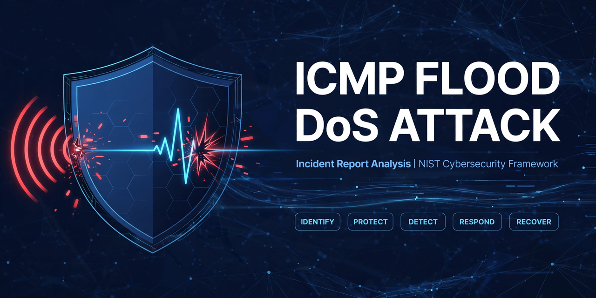

# ICMP Flood DoS Attack - Incident Report Analysis

[](https://www.nist.gov/cyberframework)
[](docs/incident-report-analysis.md)
[](docs/incident-report-analysis.md)
[](docs/remediation-checklist.md)
[](LICENSE)

> A complete, GitHub-ready analysis of an ICMP flood Denial-of-Service attack on a multimedia company, mapped to the NIST Cybersecurity Framework. It turns a single incident into a general, ongoing network security improvement plan.

**Organisation:** Multimedia company offering web design, graphic design, and social media marketing to small businesses
**Analyst role:** Cybersecurity Analyst
**Framework:** NIST Cybersecurity Framework (CSF) - Identify, Protect, Detect, Respond, Recover

---

## Table of Contents

- [Incident at a Glance](#incident-at-a-glance)
- [What Happened](#what-happened)
- [Root Cause](#root-cause)
- [How It Was Contained](#how-it-was-contained)
- [What Was Fixed After the Incident](#what-was-fixed-after-the-incident)
- [NIST CSF Analysis - Summary](#nist-csf-analysis---summary)
- [Repository Structure](#repository-structure)
- [Key Lessons](#key-lessons)
- [Next Priorities - 30 / 60 / 90 Days](#next-priorities---30--60--90-days)
- [Disclaimer](#disclaimer)

---

## Incident at a Glance

| Field | Detail |
| --- | --- |
| Attack type | ICMP Flood (Ping Flood) Denial-of-Service (DoS) |
| Vector | Flood of ICMP echo request packets into the internal network |
| Entry point | Unconfigured firewall, no rate limiting or spoofed IP filtering |
| Impact | Internal network services stopped responding, staff could not access any network resources |
| Duration | About 2 hours until contained |
| Data loss / breach | None reported. Impact was availability, not confidentiality |
| Business impact | Missed deadlines, lost productivity, delayed client design and campaign work, loss of client trust |
| Containment | Blocked incoming ICMP, took non-critical services offline, restored critical services first |
| Remediation | Firewall rate limiting, source IP verification, network monitoring, IDS/IPS filtering |

---

## What Happened

A malicious actor sent a flood of ICMP ping packets into the company's network. The volume saturated network resources, so legitimate internal traffic could not get through. Network services suddenly stopped responding.

Staff could not access file storage, design tools, internal systems, or client campaign platforms. For a company that delivers web design, graphic design, and social media marketing on tight client deadlines, an internal outage quickly becomes a client-facing problem.

The incident management team responded, contained the flood, and restored critical services within about two hours.

Full timeline and analysis: [docs/incident-report-analysis.md](docs/incident-report-analysis.md)

## Root Cause

**An unconfigured firewall.**

The firewall allowed unlimited, unverified ICMP traffic into the network. There was:

- No rate limit on incoming ICMP packets
- No source IP verification to drop spoofed addresses
- No IDS/IPS rule to filter suspicious ICMP characteristics
- No monitoring alert for abnormal ICMP volume
- No recent audit or hardening baseline for the firewall configuration

A single misconfiguration became a single point of failure. The attacker did not need to steal credentials or exploit a complex vulnerability. Volume alone was enough.

## How It Was Contained

1. **Blocked incoming ICMP packets** to stop the flood at the edge.
2. **Took all non-critical network services offline** to preserve capacity for what mattered most.
3. **Restored critical network services** first, then brought other services back in a controlled way.

Containment was effective, but it was largely ad hoc. Roles, escalation to the ISP, evidence preservation, and client communications were not documented in advance. That gap is addressed in the playbook in this repo.

## What Was Fixed After the Incident

| Control | What It Does |
| --- | --- |
| Firewall rule to limit rate of incoming ICMP packets | Stops a single source from overwhelming the network, while still allowing legitimate diagnostic traffic |
| Source IP verification on the firewall | Drops ICMP packets with spoofed or invalid source addresses, a common technique in ping floods |
| Network monitoring software | Watches for abnormal traffic patterns and raises alerts on spikes |
| IDS/IPS system | Filters ICMP traffic with suspicious characteristics, such as abnormal size, rate, pattern, or payload |

These four controls are a strong start. They are not enough on their own. This repo shows how to make them part of a layered, tested, ongoing programme.

## NIST CSF Analysis - Summary

| Function | Core Question | Verdict from This Incident |
| --- | --- | --- |
| **Identify** | Do we know what we have, what matters most, and where we are exposed? | No. No firewall audit, no prioritised asset list, no DoS risk assessment. |
| **Protect** | Do we have policies, hardening, training, and tools to reduce risk? | Partially, after the fact. Firewall was unconfigured before the attack. |
| **Detect** | Can we find an attack quickly, before it becomes an outage? | No. Detection was reactive, only after services failed. |
| **Respond** | Can we contain, neutralise, and analyse in a repeatable way? | Containment worked, but the process was ad hoc with no formal playbook. |
| **Recover** | Can we return to normal operation and restore assets in priority order? | Critical services were restored, but recovery was manual and untested. |

Detailed analysis for each function, with gaps, fixes, and improvement plans: [docs/incident-report-analysis.md](docs/incident-report-analysis.md)

## Repository Structure

```
icmp-flood-dos-nist-csf/
├── README.md                          # This file - start here
├── LICENSE                           # MIT License
├── SECURITY.md                       # How to report a security issue
├── CONTRIBUTING.md                   # How to contribute
├── .gitignore
├── assets/
│   ├── social-preview.png            # 1280 x 640 GitHub social preview cover (use this in Settings)
│   └── social-preview.webp           # Original cover source
├── docs/
│   ├── incident-report-analysis.md   # Full NIST CSF analysis - the main report
│   ├── dos-response-playbook.md      # Step by step DoS / DDoS response playbook
│   ├── remediation-checklist.md      # 30 / 60 / 90 day checklist with checkboxes
│   └── Incident-report-analysis.docx # Word version of the original template, filled in
└── .github/
    ├── PULL_REQUEST_TEMPLATE.md
    └── workflows/
        └── ci.yml                    # Markdown lint check
```

## Key Lessons

1. **Availability is a security outcome.** A DoS attack does not need to steal data to cause real harm through missed deadlines and lost trust.
2. **A single unconfigured firewall was a single point of failure.** Hardening baselines and audits prevent this.
3. **Defence in depth matters.** Rate limiting + anti-spoofing + monitoring + IDS/IPS together are stronger than any one control.
4. **Detection must be proactive.** Waiting until services fail is too late. Baselines, thresholds, and alerts are essential.
5. **Controls must be tested, not assumed.** Validate rate limits, IDS/IPS rules, and alerts with a lab flood and tabletop exercises.
6. **A larger DDoS could still saturate the ISP link.** Upstream ISP / cloud mitigation is the residual risk to address next.

## Next Priorities - 30 / 60 / 90 Days

- **30 days:** Confirm firewall baseline, back up configurations, publish the DoS playbook, define critical services and recovery order.
- **60 days:** Prove detection with a lab flood test, run a tabletop exercise, tune IDS/IPS and monitoring alerts.
- **90 days:** Complete a full risk assessment and audit, review ISP / DDoS mitigation options, test backups and recovery.

Full checklist: [docs/remediation-checklist.md](docs/remediation-checklist.md)

## Disclaimer

This repository is for education and defensive security improvement. It contains no real client data, no real IP addresses, no exploit code, and no instructions to launch an attack. Do not test flood techniques against systems you do not own or do not have explicit permission to test.

---

**If this helped you, please star the repo and share it with someone learning cybersecurity.**
