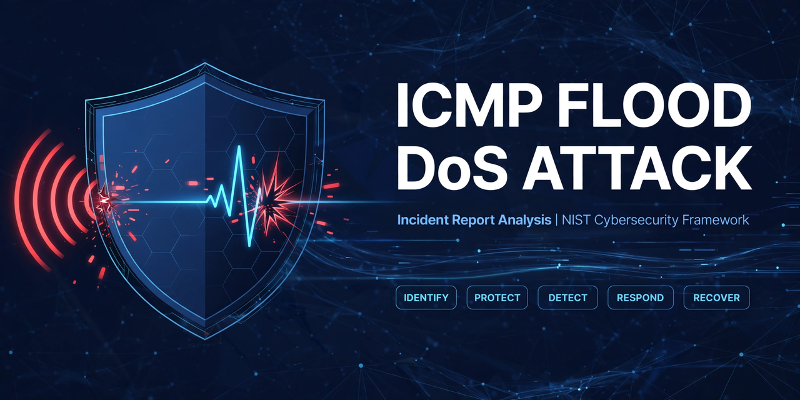

# Incident Report Analysis - ICMP Flood DoS Attack

**Organisation:** Multimedia company - web design, graphic design, and social media marketing for small businesses
**Incident:** ICMP Flood (Ping Flood) Denial-of-Service Attack
**Framework:** NIST Cybersecurity Framework (CSF)
**Analyst role:** Cybersecurity Analyst
**Outcome:** Contained in about 2 hours. No data loss or breach reported. Impact was availability, not confidentiality.

---

## Table of Contents

- [1. Executive Summary](#1-executive-summary)
- [2. Incident Timeline](#2-incident-timeline)
- [3. Technical Explanation - What Is an ICMP Flood?](#3-technical-explanation---what-is-an-icmp-flood)
- [4. Root Cause Analysis](#4-root-cause-analysis)
- [5. Business Impact](#5-business-impact)
- [6. NIST CSF Analysis](#6-nist-csf-analysis)
- [7. Remediation Already Implemented](#7-remediation-already-implemented)
- [8. Residual Risk](#8-residual-risk)
- [9. Reflections and Notes](#9-reflections-and-notes)
- [Appendix - Evidence to Preserve](#appendix---evidence-to-preserve)

---

## 1. Executive Summary

A malicious actor launched a Denial-of-Service attack that flooded the company's internal network with ICMP ping packets. The flood saturated network resources, so internal services stopped responding and staff could not access any network resources. The outage lasted about two hours until the incident team contained it.

Investigation found the root cause was an unconfigured firewall that allowed unlimited, unverified ICMP traffic into the network. There was no rate limiting, no spoofed source filtering, and no effective early detection before services failed.

The incident team blocked incoming ICMP, took non-critical services offline, and restored critical services first. After the incident, the security team added firewall rate limiting, source IP verification, network monitoring, and IDS/IPS filtering.

This report uses the NIST CSF to move beyond the one-off fix. Each function below records what the incident revealed, what was done, and what must now become routine so the same gap cannot cause the next outage.

## 2. Incident Timeline

| Phase | What Happened |
| --- | --- |
| **Attack starts** | Attacker sends a flood of ICMP echo request packets into the network through the unconfigured firewall. |
| **Services degrade** | Internal network services begin to slow, then stop responding. Legitimate internal traffic cannot reach network resources. |
| **Detection (reactive)** | Outage is noticed because staff cannot access resources. There is no automated alert for abnormal ICMP volume. |
| **Containment** | Incident team blocks incoming ICMP packets, takes non-critical services offline to preserve capacity, and restores critical services first. |
| **Investigation** | Security team confirms the flood entered via the unconfigured firewall and that no other compromise is evident. Logs, firewall state, and traffic patterns are reviewed. |
| **Remediation** | Firewall rate limiting, source IP verification, network monitoring, and IDS/IPS filtering are implemented. |
| **Post-incident** | This analysis is created. Improvement plan, playbook, and 30 / 60 / 90 day checklist are added to prevent recurrence. |

> Note: Exact timestamps and packet captures were not in the original scenario. When you adapt this report to a real incident, replace this table with real timestamps, source IPs (redacted if public), and log references.

## 3. Technical Explanation - What Is an ICMP Flood?

ICMP (Internet Control Message Protocol) is normally used for diagnostics, most famously by `ping` and `traceroute`. A host sends an ICMP echo request, and the target replies with an echo reply.

In an ICMP flood, also called a ping flood:

1. The attacker sends a very large number of ICMP echo requests, very quickly.
2. Each request forces the target and the network to spend CPU, memory, and bandwidth processing it and sending a reply.
3. Legitimate traffic is crowded out. Queues fill, devices become slow, and services stop responding.
4. If the attacker spoofs the source IP, the replies go to a victim or are untraceable, and simple source-based blocking is harder.

This is an availability attack. It does not need to steal passwords or data. Volume alone is the weapon.

Why the firewall matters: A correctly configured firewall would have limited how many ICMP packets per second could enter, dropped packets with spoofed or invalid sources, and allowed only the ICMP types the business actually needs.

## 4. Root Cause Analysis

### Direct cause
Unlimited, unverified ICMP traffic was allowed into the internal network.

### Contributing causes

- **No hardening baseline:** The firewall had never been configured to a documented secure baseline.
- **No audit:** No regular audit of firewall rules, device configurations, or access privileges caught the gap.
- **No risk assessment:** DoS / DDoS was not treated as a realistic risk for the internal network.
- **No detection baseline:** There was no definition of "normal" ICMP volume, so there was no alert for "abnormal".
- **No prioritised service list:** Critical vs. non-critical services were not defined in advance, so triage happened under pressure.
- **No tested playbook:** The response worked, but it relied on ad hoc decisions rather than a rehearsed plan.

### Root cause statement
The organisation treated the firewall as "installed" rather than "configured, audited, and monitored". Security was a one-time setup, not an ongoing process.

## 5. Business Impact

For a multimedia company, the impact is both internal and client-facing:

- **Internal:** Staff could not access design files, internal systems, or collaboration tools for about 2 hours.
- **Client work:** Web design deadlines, graphic design reviews, and scheduled social media campaigns were delayed.
- **Trust:** Clients expect reliability. An unexplained outage, even without data loss, reduces confidence.
- **Revenue:** Lost productivity plus potential rework, rescheduling, and goodwill costs.
- **No data breach:** No evidence of data loss or unauthorised access to client data was reported. This limits legal and notification impact, but it does not remove the need to verify integrity after recovery.

## 6. NIST CSF Analysis

The NIST CSF organises security into five functions. The original template for this report uses those five functions. Each section below follows the same structure: what the function means, what this incident revealed, what was fixed, and the improvement plan.

---

### Identify

**What Identify means:** Know what you have, what matters most, and where you are exposed, through regular audits of internal networks, systems, devices, and access privileges.

**What this incident revealed:**

- The firewall had never been audited or hardened to a baseline, so a basic misconfiguration went unnoticed until it was exploited.
- There was no documented, tested list of critical vs. non-critical services. The team had to decide under pressure which services to take offline and which to restore first.
- DoS / DDoS was not treated as a realistic risk for the internal network, so no risk assessment, threat model, or owner was in place for this scenario.

**Improvement plan - make Identify continuous:**

1. **Inventory and classify:** Maintain a live asset inventory and network diagram: firewalls, routers, switches, servers, workstations, cloud / SaaS tools for design and social media, client data stores, and who owns each asset.
2. **Audit configs and privileges:** Audit firewall rules and device configurations quarterly, and after every change, against a hardening baseline. Review who can change firewall rules and remove stale or overly broad rules.
3. **Assess risk:** Run vulnerability scans and a formal risk assessment at least annually, including a DoS / DDoS scenario. Record risks, likelihood, business impact, and owners in a risk register.
4. **Prioritise by impact:** Define business impact in advance: which services are critical for client web, design, and campaign work, what the recovery order is, and what downtime costs in deadlines, trust, and revenue.
5. **Map dependencies:** Review third-party dependencies - ISP, hosting, and social / design platforms - and confirm what upstream DoS protection they provide.

**Success measures:** 100% of assets inventoried, quarterly firewall audit completed, risk register reviewed, critical services list approved by management.

---

### Protect

**What Protect means:** Policies, procedures, training, and tools that reduce the chance and impact of an attack.

**What was fixed after the incident:**

- **Firewall rate limiting:** Rate limiting stops a single source from overwhelming the network with ICMP, while still allowing legitimate diagnostic traffic.
- **Anti-spoofing:** Source IP verification drops ICMP packets with spoofed or invalid source addresses, a common technique in ping floods.
- **IDS/IPS filtering:** IDS/IPS rules filter ICMP with suspicious characteristics, such as abnormal size, rate, pattern, or payload, before it reaches internal hosts.

**Improvement plan - harden and prevent by design:**

1. **Harden and control the firewall:** Adopt a firewall hardening baseline with deny-by-default, change control, peer review, and automatic backup of configurations. Document exactly which ICMP types are allowed and why. For example, allow limited echo for internal diagnostics, allow Destination Unreachable / Time Exceeded where needed, block or tightly limit external echo. Test that legitimate tools still work.
2. **Segment:** Segment the network. Separate internal workstations, servers / design storage, DMZ / public-facing services, and guest Wi-Fi. Limit lateral movement if one segment is flooded or compromised.
3. **Reduce attack surface:** Apply least privilege and MFA for firewall / network admin access, patch network devices promptly, and disable unused ports, protocols, and services.
4. **Plan for scale:** Agree upstream protection with the ISP and consider cloud DDoS mitigation / scrubbing for larger volumetric attacks that would saturate the internet link before the firewall can help.
5. **Train and document:** Train all staff on recognising an outage / attack, who to report to, and secure configuration practices. Train network admins on firewall review and DoS playbooks.
6. **Policy:** Write and approve policies for firewall change, acceptable use, patching, and access review, and review them after every incident.

**Success measures:** Zero firewall rules without owner and justification, MFA enforced for all network admin access, patch SLA met, segmentation diagram current.

---

### Detect

**What Detect means:** Find a potential incident quickly, before it becomes a full outage, and improve monitoring to increase speed and efficiency.

**What this incident revealed:**

- Detection was reactive. The attack was only noticed when services stopped responding. There was no alert for abnormal ICMP volume, bandwidth, or latency.

**What was fixed after the incident:**

- **Monitoring:** Network monitoring software now watches for abnormal traffic patterns and can raise alerts on spikes.
- **IDS/IPS detection:** IDS/IPS now inspects ICMP and can alert on or block suspicious characteristics.

**Improvement plan - detect faster and more reliably:**

1. **Baseline and alert:** Build a baseline for normal traffic (ICMP packets per second, bandwidth, latency, per-host and per-service) and set thresholds and alerts for deviations. Alert the on-call analyst, not just log the event.
2. **Centralise visibility:** Centralise logs and flows (firewall, IDS/IPS, NetFlow / sFlow, server logs) in one monitoring / SIEM view with at least 90-day retention for investigation.
3. **Tune and measure:** Tune IDS/IPS rules to balance detection and false positives, and review alerts weekly. Track Mean Time to Detect (MTTD). Target under 5 minutes for a flood.
4. **Make it actionable:** Add dashboards for real-time network health and a simple escalation path: who is paged, what they check first, and when to escalate to the ISP.
5. **Test detection:** Test detection with a controlled ICMP flood in a lab / test segment and with tabletop exercises, so alerts are proven, not assumed, to work.

**Success measures:** MTTD under 5 minutes in a lab test, alert triage time tracked, false positive rate reviewed weekly.

---

### Respond

**What Respond means:** Contain, neutralise, and analyse security incidents, and implement improvements to the security process.

**What worked in this incident:**

- The incident team blocked incoming ICMP, took non-critical services offline to preserve capacity, and restored critical services. Containment within about two hours limited wider business disruption.

**Gaps to close:**

- The response was largely ad hoc. Roles, decision authority, internal / client communications, evidence preservation, and escalation to the ISP were not clearly documented in advance.

**Improvement plan - a repeatable DoS response playbook:**

1. **Roles and authority:** Publish an Incident Response (IR) plan with named roles: Incident Commander, Network / Security lead, Communications lead, and Management sponsor. Define who can block traffic, take services offline, or contact the ISP.
2. **DoS playbook:** Create a DoS / DDoS playbook: verify the attack (traffic source, type, volume) then contain (block / rate-limit / filter, engage ISP) then eradicate (remove spoofed / malicious sources, confirm filters hold) then recover (see Recover) then lessons learned. Full playbook: [dos-response-playbook.md](dos-response-playbook.md)
3. **Preserve evidence:** Save firewall, IDS/IPS, and monitoring logs, packet captures, timestamps, and actions taken, for forensics and for any report to the ISP or law enforcement.
4. **Communicate:** Communicate early and clearly: internal status updates for staff, and timely, honest updates for affected clients about delays to design / campaign work, without speculating on attribution.
5. **Learn and rehearse:** Hold a post-incident review within 5 business days, update the IR plan and playbooks with what was learned, and run a tabletop exercise at least quarterly.

**Success measures:** IR plan published and tested, post-incident review completed, tabletop exercise held quarterly, Mean Time to Respond (MTTR) tracked.

---

### Recover

**What Recover means:** Return affected systems to normal operation and restore systems data and / or assets that have been affected by an incident.

**What happened in this incident:**

- Critical services were restored first, after non-critical services were taken offline to reduce load. No data loss or breach of client data was reported. The impact was availability, not confidentiality. Recovery was manual and untested in advance.

**Improvement plan - make recovery planned, prioritised, and tested:**

1. **Prioritised recovery order:** Define a recovery order in advance, aligned to Identify: restore critical services first (client-facing web / design systems, file storage, communications), then non-critical services only after validation.
2. **Backups and objectives:** Set Recovery Time / Recovery Point Objectives (RTO / RPO) for critical services, back up configurations and design / client files regularly, and test restores. A backup that has never been restored is not a backup.
3. **Verify and monitor:** Verify integrity after recovery: confirm services are fully functional, check for lingering malicious traffic or misconfiguration, and monitor closely for a repeat flood in the 48 to 72 hours after restoration.
4. **Phased return and comms:** Return non-critical services in phases with checks, and communicate to staff and clients when normal service resumes and whether any deadlines will shift.
5. **Close the loop:** Feed recovery lessons back into Identify, Protect, and Detect. For example, if recovery took two hours, what redundancy, failover, or spare capacity would cut that time?

**Success measures:** RTO / RPO defined for all critical services, backup restore test passed, recovery drill completed, post-recovery monitoring checklist completed.

---

## 7. Remediation Already Implemented

| Control | Status | Effect |
| --- | --- | --- |
| Firewall rule to limit rate of incoming ICMP | Implemented | Limits flood volume at the edge |
| Source IP verification for spoofed IPs | Implemented | Drops spoofed ICMP |
| Network monitoring for abnormal traffic | Implemented | Earlier detection of spikes |
| IDS/IPS filtering for suspicious ICMP | Implemented | Blocks abnormal ICMP characteristics |

## 8. Residual Risk

- **Larger distributed attack:** A DDoS from many sources / a botnet could still saturate the internet link before the on-premise firewall can help. Mitigation: ISP and cloud DDoS scrubbing.
- **Misconfigured rate limit:** If the limit is too strict, legitimate diagnostics break. If too loose, it does not stop a flood. Mitigation: test and tune, with an allowlist for known monitoring hosts.
- **Alert fatigue:** If IDS/IPS or monitoring alerts are too noisy, real alerts will be ignored. Mitigation: weekly tuning and triage review.
- **No tested recovery:** Backups and recovery order are still untested in this scenario. Mitigation: scheduled restore test and recovery drill.

## 9. Reflections and Notes

- **Key lesson:** A single unconfigured firewall was a single point of failure. Availability is a security outcome. A DoS attack does not need to steal data to cause real harm through missed deadlines, lost productivity, and loss of client trust.
- **Layered controls:** Defence in depth matters. No single control would have stopped this attack alone. Rate limiting + anti-spoofing + monitoring + IDS/IPS together are stronger than any one of them.
- **Residual risk - DDoS at scale:** A larger, distributed attack could still saturate the internet link before the firewall sees it. Upstream ISP / cloud mitigation, not just on-premise filtering, is the residual risk to address next.
- **Test, do not assume:** Controls must be tested, not assumed. Validate that rate limits do not break legitimate diagnostics, that IDS/IPS rules fire on a test flood, and that monitoring alerts reach the right person within minutes.
- **Ongoing discipline:** Security is ongoing: quarterly audits, continuous monitoring, regular training, and rehearsed playbooks turn this incident from a one-time fix into lasting resilience.

**Next priorities (30 / 60 / 90 days):** 30 days - confirm firewall baseline, back up configs, and publish the DoS playbook. 60 days - prove detection with a lab flood test and run a tabletop exercise. 90 days - complete a full risk assessment and audit, and review ISP / DDoS mitigation options.

Full checklist: [remediation-checklist.md](remediation-checklist.md)

---

## Appendix - Evidence to Preserve

For any future incident, preserve:

- Firewall logs (before, during, after)
- IDS/IPS alerts and packet captures (PCAP)
- Network monitoring graphs and NetFlow / sFlow data
- Server and workstation logs
- Timeline of actions taken, who took them, and when
- Communications sent to staff and clients
- Post-incident review notes

Store evidence in a secure, access-controlled location with retention per policy. Do not publish real IPs or client data in a public repo.
